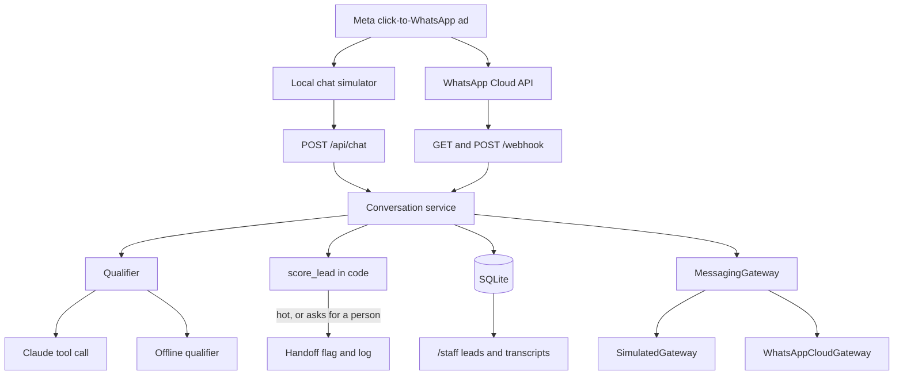

# Horizon Sample Travel — WhatsApp lead bot

A small lead-qualification bot for a fictional travel agency. A traveller taps a Meta (Facebook or Instagram) click-to-WhatsApp ad, Maya answers in the chat, asks for the trip details a sales desk actually needs, and hands the thread over when the lead is hot or when the person asks for a human.

Phase 1 runs entirely on your machine. The chat page behaves like WhatsApp. `POST /webhook` already accepts the [WhatsApp Cloud API](https://developers.facebook.com/docs/whatsapp/cloud-api/webhooks/payload-examples) payload, so a real number can be attached later without rewriting the bot.

Horizon Sample Travel is not a real agency. Packages, prices, and ad ids under `app/knowledge.py` are **sample data**.

## Architecture



The messaging layer is an interface in `app/messaging.py`. `SimulatedGateway` only mints an id; the transcript is stored by the service. `WhatsAppCloudGateway` builds the real Graph API request and sends it when `WHATSAPP_TOKEN` and `WHATSAPP_PHONE_NUMBER_ID` are set. Until then `send_text` raises `NotImplementedError` with the TODO still open.

Claude extracts facts by calling `record_lead_qualification` (strict tool use). **Scoring is not left to the model.** `app/scoring.py` is the rule, so the boundary of a hot lead is something you can change and test without re-prompting.

| Score | Rule |
| --- | --- |
| Cold | No destination yet |
| Warm | Destination is known, but dates, group size, budget, or name is still missing — or the budget is under $800 |
| Hot | Destination, dates, group size, budget of at least $800, and a booking name |

Handoff happens when the score is hot, or when the traveller asks for a person, at any score. After that Maya stops extracting and the thread is marked for sales. One conversation is kept per phone number.

Claude Sonnet 5.5 does not accept a forced tool choice (`tool_choice` of `any` or `tool` returns 400). The call uses `tool_choice: auto`, a strict schema, and a prompt that tells Maya to call the tool every turn. `thinking` is `between_tools` so a chat turn does not do a long hidden reasoning pass (`disabled` is also rejected on this model). If the model replies in plain text anyway, that text is sent and no new facts are written.

With no API key, `LLM_PROVIDER` defaults to `mock`: a small keyword extractor in `app/extract.py`. It is there so you can click through the product. It is not the reader you ship.

## Run it

```bash
python -m venv .venv
source .venv/bin/activate
pip install -r requirements.txt
cp .env.example .env
uvicorn app.main:app --reload
```

On Windows, activate with `.venv\Scripts\activate` instead of `source`.

Open [http://127.0.0.1:8000](http://127.0.0.1:8000). Pick a sample ad, chat with Maya, and watch the qualification panel. The sales view is [http://127.0.0.1:8000/staff](http://127.0.0.1:8000/staff). Interactive API docs are at `/docs`.

To answer with Claude, set this in `.env` and restart:

```bash
LLM_PROVIDER=anthropic
ANTHROPIC_API_KEY=sk-ant-...
```

The default model is `claude-sonnet-5-5` (`ANTHROPIC_MODEL`).

Tests do not call Anthropic. They pass a fake client or the offline qualifier:

```bash
pytest
```

### Docker

```bash
docker build -t horizon-leads .
docker run --rm -p 8000:8000 --env-file .env -v horizon-data:/data horizon-leads
```

The image stores SQLite at `/data/travel.db`. Leave `SQLITE_PATH` commented out in `.env` so that path is not overridden.

## Layout

| Path | What it is |
| --- | --- |
| `app/main.py` | FastAPI routes: simulator, staff pages, webhook |
| `app/service.py` | One inbound turn: store, qualify, score, maybe hand off, deliver |
| `app/llm.py` | Claude tool call, and the offline qualifier |
| `app/scoring.py` | Hot / warm / cold and the handoff decision |
| `app/extract.py` | Keyword stand-in used only offline |
| `app/knowledge.py` | Fictional packages and ad ids |
| `app/messaging.py` | Gateway interface, Cloud API stub, webhook parser |
| `app/db.py` | SQLite: conversations, messages, leads |
| `app/templates/` | Chat simulator and staff desk |

## Try the webhook without Meta

This is the same shape Meta posts when someone messages the business number from an ad. `source_id` matches a sample ad, so the lead is tagged with that campaign.

```bash
curl -s -X POST http://127.0.0.1:8000/webhook \
  -H 'content-type: application/json' \
  -d '{
    "object": "whatsapp_business_account",
    "entry": [{
      "id": "WABA",
      "changes": [{
        "field": "messages",
        "value": {
          "messaging_product": "whatsapp",
          "metadata": {
            "display_phone_number": "15550001111",
            "phone_number_id": "PHONE_ID"
          },
          "contacts": [{"profile": {"name": "Jamie"}, "wa_id": "15551230000"}],
          "messages": [{
            "from": "15551230000",
            "id": "wamid.DEMO1",
            "timestamp": "1762000000",
            "type": "text",
            "text": {"body": "We are 4 people going to Bali June 12-19 2026. Budget is 4000. My name is Jamie Lee."},
            "referral": {
              "source_url": "https://fb.me/bali",
              "source_id": "ad_bali_summer_01",
              "source_type": "ad",
              "headline": "7 days in Bali from $1,299"
            }
          }]
        }
      }]
    }]
  }'
```

Then refresh `/staff`. Meta also sends status callbacks (`delivered`, `read`); those are acknowledged and ignored. The same `id` posted twice is stored once.

The verify handshake Meta uses when you save the webhook is `GET /webhook?hub.mode=subscribe&hub.verify_token=...&hub.challenge=...`. The response body is the challenge as plain text.

## Connecting real WhatsApp

1. In [Meta for Developers](https://developers.facebook.com/), create an app, add the WhatsApp product, and note the **phone number id** and a **token**. A temporary token is enough to try. A system-user token is what you keep.
2. Put them in `.env`:

   ```bash
   MESSAGING_PROVIDER=whatsapp
   WHATSAPP_TOKEN=...
   WHATSAPP_PHONE_NUMBER_ID=...
   WHATSAPP_VERIFY_TOKEN=horizon-sample-verify
   WHATSAPP_APP_SECRET=...
   ```

   `WHATSAPP_APP_SECRET` is the app secret. When it is set, `POST /webhook` must carry a valid `X-Hub-Signature-256`. Leave it empty only on your machine.
3. Expose the app on public HTTPS (ngrok, or the Docker host). In the WhatsApp configuration, set the callback URL to `https://<your-host>/webhook` and the verify token to the same string as `WHATSAPP_VERIFY_TOKEN`. Subscribe to the **messages** field.
4. Restart. An inbound Cloud API message follows the same path as the simulator. The reply is `POST`ed to `https://graph.facebook.com/v21.0/{phone-number-id}/messages`.

Still to do before this is a production inbox — the notes live on `WhatsAppCloudGateway` in `app/messaging.py`:

- Outside the 24-hour customer-care window, WhatsApp requires a pre-approved **template** message. This demo only sends session text.
- Acknowledge the webhook and send from a queue. The demo answers inside the request. Meta retries when you return a non-200, and a retry of a message id we already stored will not send again.
- Do not log message bodies. The transcript is in SQLite; logs should stay limited to ids and scores.
- Put `/staff` behind a login before anyone but you can open the URL. There is no auth in this demo.
- Campaign names are **not** in Meta's webhook. `referral.source_id` is the ad id. This app looks that id up in `SAMPLE_ADS`. A real desk would look it up in its own ad catalog.

## What this demo leaves out

- After handoff, Maya does not keep qualifying. Sales owns the thread.
- The offline qualifier is keywords. Typos and phrasing it does not know stay unextracted; Claude is the reader that handles those.
- The $800 floor and the five required fields are constants in `app/scoring.py`, not a trained model.
- No media, no WhatsApp templates, no payments.
