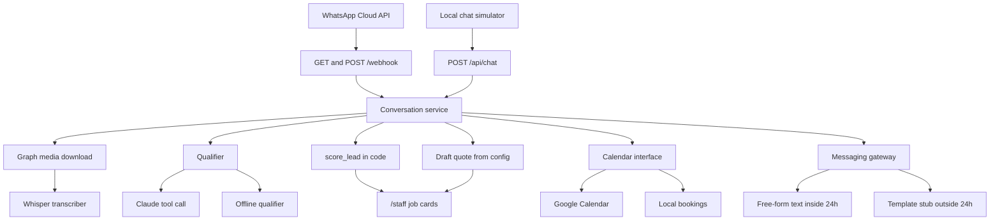
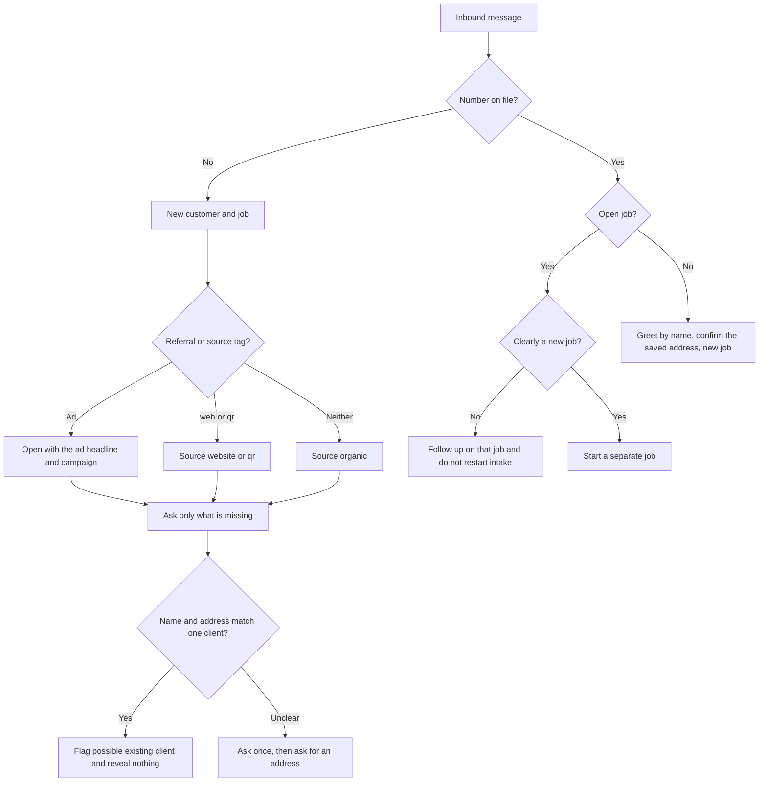

# Northside Electrical — WhatsApp assistant for tradies

A WhatsApp assistant for an Australian trade business. Electricians first: a customer messages the business number, the bot collects the job (type, suburb, urgency, description, photos, a preferred time, and a name), offers three free visit slots, and hands the thread to the desk when the job is urgent or a good fit. Draft price ranges stay on the staff desk until a person sends them.

The trade is config. Edit `config/business.json` — business name, service-area suburbs, job types, hours, and draft price bands — and the same app serves another trade. Northside Electrical in that file is sample config, not a live tariff.

## Architecture



## Routing

Every inbound message goes through one decision, before intake:



A number is known when it is already in `customer_numbers` — including clients imported from CSV. An open job is `open`, `quoted`, or `booked`. `completed` and `cancelled` are closed, so the next message starts a new job.

Follow-up on an open job answers a status question from that job's booking, attaches a photo or voice note, or hands the chat to the tradie. It does not run the intake questions again after handoff. "Clearly a new job" is classified by Claude when `LLM_PROVIDER=anthropic`. With no key, a phrase list is the stand-in (`different job`, `another job`, and similar). Tests pass a fake classifier and never call Anthropic.

Job source is one of `ad`, `organic`, `website`, `qr`, or `repeat`. A Meta referral is `ad`, and the first reply names the headline and campaign. A configured prefilled tag in `config/business.json` (`(web)`, `(qr)`, and whatever you add under `source_tags`) sets `website` or `qr` and is removed before the qualifier reads the text. A known number with neither is `repeat`. Anything else is `organic`.

A brand-new number is not told that it matches anyone. If the name and address they give match exactly one saved customer, the job is flagged **possible existing client** for the desk. The bot does not say it knows them, and it does not mention that customer's other jobs, quotes, addresses, or bookings. If the name matches but the address does not, the bot may ask once: "Have we done work for you before?" A yes is followed by "What address did we do that work at?" Staff confirm the match by linking the number. Until then the number stays its own customer.

## Scoring

Scoring is not left to the model. `app/scoring.py` decides hot, warm, and cold from the business config.

| Score | Rule |
| --- | --- |
| Cold | No job type yet |
| Warm | A job type is known, but the suburb is outside the service area, or urgency, description, or a name is still missing |
| Hot | An emergency inside the service area, or a configured job type with an in-area suburb, urgency, description, and a name |

Handoff happens when the score is hot, or when the customer asks for a person, at any score. After that the bot stops extracting on that job. A slot the customer already picked can still be booked. A later message that is clearly a new job starts intake again. One chat thread is kept per phone number. A customer can have several numbers and several jobs.

Quotes are a min–max range from `config/business.json`. They are saved as drafts. The bot never puts a dollar amount in a customer reply. Someone on `/staff` approves the draft, and only then is it sent.

Visit times come from `Calendar`. With Google credentials that is the Calendar API (service account or OAuth). Without them, bookings live in SQLite so the simulator still works. The customer is offered the next three free slots inside the configured hours, and the slot they pick is booked.

Claude Sonnet 5.5 does not accept a forced tool choice (`tool_choice` of `any` or `tool` returns 400). The call uses `tool_choice: auto`, a strict schema, and a prompt that tells the assistant to call `record_job_intake` every turn. `thinking` is `between_tools`. If the model replies in plain text anyway, that text is sent and no new facts are written. Any sentence that still contains a price is removed before send.

With no API key, `LLM_PROVIDER` defaults to `mock`: a keyword extractor in `app/extract.py`. It is there so you can click through the product. It is not the reader you ship.

## Run it locally

```bash
python -m venv .venv
source .venv/bin/activate
pip install -r requirements.txt
cp .env.example .env
uvicorn app.main:app --reload
```

On Windows, activate with `.venv\Scripts\activate`.

Open [http://127.0.0.1:8000](http://127.0.0.1:8000). Pick a sample ad, chat, and watch the job card. The desk is [http://127.0.0.1:8000/staff](http://127.0.0.1:8000/staff). Interactive API docs are at `/docs`.

To answer with Claude:

```bash
LLM_PROVIDER=anthropic
ANTHROPIC_API_KEY=sk-ant-...
```

The default model is `claude-sonnet-5-5` (`ANTHROPIC_MODEL`).

Tests do not call Anthropic, OpenAI, Meta, or Google. They pass fakes:

```bash
pytest
```

### Docker

```bash
docker build -t tradie-whatsapp .
docker run --rm -p 8000:8000 --env-file .env -v tradie-data:/data tradie-whatsapp
```

The image stores SQLite at `/data/tradie.db`. Leave `SQLITE_PATH` commented out in `.env` so that path is not overridden. The process listens on `PORT` (8000 if unset).

## Render

`render.yaml` is a Docker web service on the **Starter** plan. Starter is paid and does not sleep, so Meta can reach the webhook. A free web service spins down and drops verification and message retries.

The health check is `GET /api/health`. A 1 GB disk is mounted at `/data` for SQLite and downloaded photos and voice notes.

1. Push this repo to GitHub.
2. In Render, create a Blueprint and point it at the repo. Render reads `render.yaml`.
3. Fill the environment variables it prompts for (see the table below). `STAFF_SESSION_SECRET` is generated.
4. Deploy. The service URL is `https://<service>.onrender.com`.
5. In Meta, set the callback URL to `https://<service>.onrender.com/webhook`.

`MESSAGING_PROVIDER` is `whatsapp` and `LLM_PROVIDER` is `anthropic` in the blueprint. Until `WHATSAPP_TOKEN` and `PHONE_NUMBER_ID` are set, outbound sends are skipped and logged; inbound messages are still stored.

## Environment variables

| Variable | Purpose |
| --- | --- |
| `WHATSAPP_TOKEN` | Permanent system-user token for the Cloud API |
| `PHONE_NUMBER_ID` | WhatsApp phone number id. `WHATSAPP_PHONE_NUMBER_ID` is also accepted |
| `VERIFY_TOKEN` | String you type into the Meta webhook form. `WHATSAPP_VERIFY_TOKEN` is also accepted |
| `APP_SECRET` | Meta app secret. When set, `POST /webhook` must carry a valid `X-Hub-Signature-256`. `WHATSAPP_APP_SECRET` is also accepted |
| `ANTHROPIC_API_KEY` | Claude. Required when `LLM_PROVIDER=anthropic` |
| `ANTHROPIC_MODEL` | Defaults to `claude-sonnet-5-5` |
| `OPENAI_API_KEY` | Whisper. Voice notes are stored without a transcript until this is set |
| `WHISPER_MODEL` | Defaults to `whisper-1` |
| `GOOGLE_SERVICE_ACCOUNT_JSON` | Service-account key JSON, as one line. Share the calendar with that account's email |
| `GOOGLE_APPLICATION_CREDENTIALS` | Or a path to the same JSON file |
| `GOOGLE_OAUTH_CLIENT_ID` | OAuth client, if you are not using a service account |
| `GOOGLE_OAUTH_CLIENT_SECRET` | OAuth client secret |
| `GOOGLE_OAUTH_REFRESH_TOKEN` | Refresh token with Calendar scope |
| `GOOGLE_CALENDAR_ID` | Calendar to read and write. Required when either Google path is set |
| `STAFF_USERNAME` | Desk login. Both username and password must be set or `/staff` stays open |
| `STAFF_PASSWORD` | Desk password |
| `STAFF_SESSION_SECRET` | Signs the session cookie. Render generates one |
| `BUSINESS_CONFIG` | Optional path to a different `business.json` |
| `SQLITE_PATH` | Defaults to `data/tradie.db`. On Render, `/data/tradie.db` |
| `MESSAGING_PROVIDER` | `simulated` or `whatsapp` |
| `LLM_PROVIDER` | `mock` or `anthropic` |

Use either the service account or the OAuth trio. If both are set, the service account wins. If neither is set, slots are booked into SQLite only.

## Meta setup you do by hand

The app cannot create a Meta business or approve templates.

1. **Business verification.** In [Meta Business Manager](https://business.facebook.com/), create or claim the business and complete business verification. An unverified business cannot use a production WhatsApp number for long.
2. **App and WhatsApp product.** In [Meta for Developers](https://developers.facebook.com/), create an app, add WhatsApp, and attach a WhatsApp Business Account and a phone number. Copy the phone number id into `PHONE_NUMBER_ID`.
3. **Token.** Create a system user with the WhatsApp permission and a permanent token. Put it in `WHATSAPP_TOKEN`. A temporary dashboard token expires.
4. **App secret.** Copy the app secret into `APP_SECRET`. `POST /webhook` then rejects any body whose `X-Hub-Signature-256` is not `sha256=` plus HMAC-SHA256 of the raw body.
5. **Webhook.** Callback URL `https://<your-host>/webhook`, verify token equal to `VERIFY_TOKEN`. Subscribe the app to the **messages** field. Meta's handshake is `GET /webhook?hub.mode=subscribe&hub.verify_token=...&hub.challenge=...`; the response body is the challenge as plain text.
6. **Templates.** Outside the 24-hour window the app sends template names `booking_confirmation` and `quote_followup`. Those are stubs. Create and approve templates with those names in WhatsApp Manager, or change the constants in `app/window.py` (they are marked TODO) to the approved names. Until then, an outside-window send is rejected by Meta and the quote stays a draft if the API errors.

Status callbacks (`delivered`, `read`) are acknowledged and ignored. The same message id posted twice is stored once.

## Google Calendar you do by hand

1. In Google Cloud, enable the Calendar API.
2. Create a service account and download the JSON. Put the JSON on one line in `GOOGLE_SERVICE_ACCOUNT_JSON`, or mount the file and set `GOOGLE_APPLICATION_CREDENTIALS`.
3. In Google Calendar, share the tradie's calendar with the service-account email, with permission to change events.
4. Set `GOOGLE_CALENDAR_ID` to that calendar's id.

OAuth is the other path: a client id, secret, and refresh token that already has `https://www.googleapis.com/auth/calendar`. No browser flow runs inside the app.

## Staff desk

`/staff` lists job cards: type, suburb, urgency, description, photos, voice-note transcript and summary, the offered or booked visit, the job status and source, and the draft quote. **Approve and send quote** is the only way a price leaves the building.

`/staff/customers` lists each customer with their numbers, addresses, notes, and jobs. A job flagged as a possible existing client can be linked to that customer, which moves the new number and its jobs onto the saved record. On a job you can split a message onto a new job, move a message to another job of the same customer, or set the status to completed or cancelled.

Import existing clients from the desk (CSV upload) or from the shell:

```bash
python -m app.import_clients clients.csv --dry-run
python -m app.import_clients clients.csv
```

The file needs `name` and `phone` columns. `address` and `notes` are optional. Several numbers can sit in the phone cell, separated by `;` or `/`. `0412 345 678` is stored as `61412345678` — WhatsApp's country code plus number, with no plus sign. `--db` overrides `SQLITE_PATH`.

Set `STAFF_USERNAME` and `STAFF_PASSWORD` before the Render URL is shared. With both set, every `/staff` page, the customer pages, the import, and the link, split, reassign, and approve actions require a session cookie. With either empty, the desk is open and a warning is logged — that is the local simulator only.

## 24-hour window

WhatsApp allows free-form replies for 24 hours after the customer's last message. A reply to an inbound message is inside that window and is sent as text. A staff quote (or a booking confirmation) sent after the window has closed uses the template stub instead of free text. Session replies that somehow fall outside the window are held, not sent as free text.

## Voice notes and photos

Audio and image messages are downloaded from the Graph API (`GET /{media-id}`, then `GET` the returned URL, both with the bearer token). Audio is transcribed through `Transcriber`. `OpenAIWhisperTranscriber` posts to `https://api.openai.com/v1/audio/transcriptions`. Swap that class to change providers. The transcript and a one-sentence summary are stored on the job card, and the transcript is what the qualifier reads. Photos are saved under the data directory and linked from the job card.

## Try the webhook without Meta

```bash
curl -s -X POST http://127.0.0.1:8000/webhook \
  -H 'content-type: application/json' \
  -d '{
    "object": "whatsapp_business_account",
    "entry": [{
      "id": "WABA",
      "changes": [{
        "field": "messages",
        "value": {
          "messaging_product": "whatsapp",
          "metadata": {"display_phone_number": "15550001111", "phone_number_id": "PHONE_ID"},
          "contacts": [{"profile": {"name": "Jamie"}, "wa_id": "15551230000"}],
          "messages": [{
            "from": "15551230000",
            "id": "wamid.DEMO1",
            "timestamp": "1762000000",
            "type": "text",
            "text": {"body": "The safety switch keeps tripping in Newtown. Not urgent. It trips when the oven is on. My name is Jamie Lee."}
          }]
        }
      }]
    }]
  }'
```

Then open `/staff`. With `APP_SECRET` set, compute `X-Hub-Signature-256` or the POST is rejected with 403.

## Layout

| Path | What it is |
| --- | --- |
| `render.yaml` | Render Docker web service, Starter plan, health check, disk |
| `config/business.json` | Trade, suburbs, hours, job types, draft price bands, sample ads |
| `app/main.py` | Simulator, staff desk and login, customer view, quote approval, webhook |
| `app/service.py` | One inbound turn: route, store, media, book, qualify, score, deliver |
| `app/routing.py` | Job source, new-job classification, soft match |
| `app/customers_io.py` | CSV import shared by the desk and the CLI |
| `app/import_clients.py` | `python -m app.import_clients` |
| `app/phones.py` | Australian numbers to WhatsApp digits |
| `app/scoring.py` | Hot / warm / cold and the handoff decision |
| `app/quotes.py` | Draft ranges and the price scrubber |
| `app/booking.py` | Slot finder and the calendar interface |
| `app/window.py` | 24-hour window and template-name stubs |
| `app/media.py` | Graph download and the Whisper transcriber |
| `app/llm.py` | Claude tool call, and the offline qualifier |
| `app/messaging.py` | Gateway, signature check, webhook parser |

## What you still do yourself

- Meta business verification, the phone number, the permanent token, and the webhook subscription to **messages**
- Approved template names for `booking_confirmation` and `quote_followup`
- Anthropic and OpenAI keys
- A Google calendar shared with the service account, or an OAuth refresh token
- Staff username and password
- Your own business name, suburbs, job types, hours, price bands, and source tags in `config/business.json`
- A backup of the SQLite file before the first deploy of this change. On startup, each existing conversation becomes a customer, one WhatsApp number, and one job. Job ids stay the same as the old lead ids. Finished historical jobs are still `open` until you mark them completed or cancelled — until you do, the next message from that number stays on the old job
- A CSV of existing clients, if you want a known number to be greeted by name instead of treated as new
- A look at any job flagged **possible existing client**, and a link when the number really is that customer

There is no Twilio and no n8n in this app.
